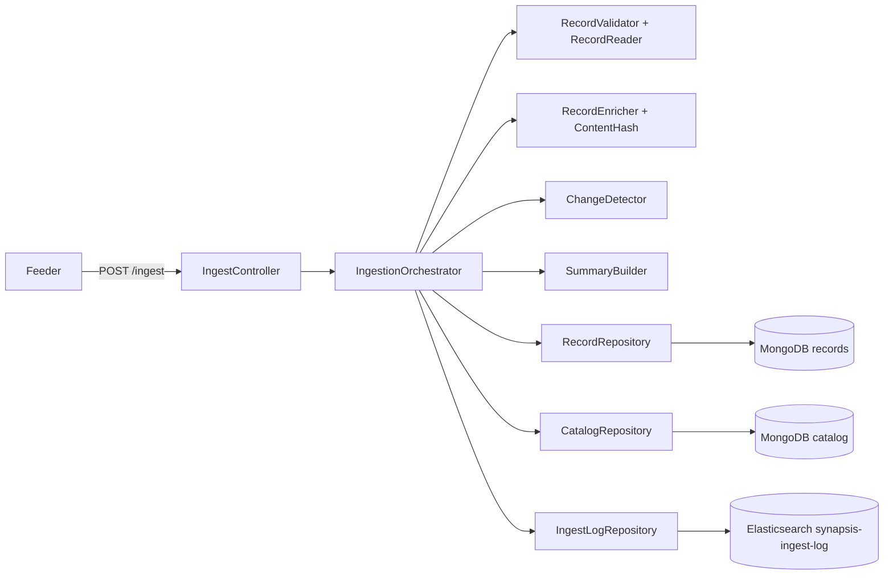
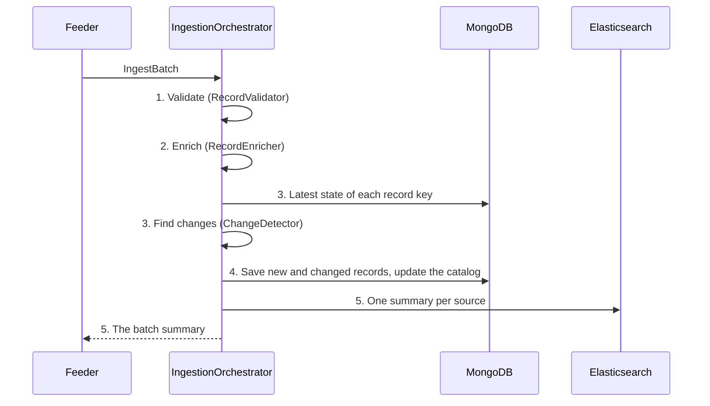

# Understanding the Synapsis API

A walk through the C# API for a developer new to the project: what it does, the parts it is made of, and what
happens, step by step, for each route. The code is in `src/dotnet/`; the contract is `contracts/synapsis-api.yaml`.

## 1. What the API does

Feeders send **batches** of records (up to 5,000) to `POST /ingest`. The API checks what every record shares, stores
each new or changed record in MongoDB with a **state** number, adds its source and type to the **catalog**, and writes
a **summary** of the batch to Elasticsearch (the UI reads it there) and back to the feeder. `GET /records/{id}` reads a
record back as it was known at a date; `GET /catalog` lists every source and type that has entered.

## 2. Words you need first

| Word | Meaning |
| --- | --- |
| Record | One SIL 1.2 object: an entity, event, relation or conclusion. Every record has `kind`, `id`, `type`, `source`, `known_at` |
| Batch | `{batch_id, producer, records: [...]}`, the body of `POST /ingest` |
| Record key | `id` + `source`. The same id from two sources is two records |
| State | How many times a record (same key) was stored with new content: 1 for the first copy, then 2, 3, ... Earlier states are never changed |
| Content hash | SHA-256 of the record's JSON without `known_at` and `known_at_basis`. Same hash = same content |
| Catalog | One MongoDB document per value that entered: each source, each entity/event/relation/conclusion type |
| Summary | `IngestSummary`: how many records were received, new, changed, unchanged, duplicates, rejected, and why |

## 3. The parts

| Project | Folder | Holds |
| --- | --- | --- |
| `Synapsis.Api` | `Controllers/` | The three routes; each calls one thing |
| | `Orchestrators/` | `IngestionOrchestrator`: the five steps of ingestion, in order, one call each |
| | `Services/` | The steps themselves, as static classes (pure code, no database) |
| | `Models/` | The batch, the four record classes, the step answers (`ValidationResult`, `ChangeResult`), `RecordAnswer` |
| `Synapsis.Storage` | `Models/` | What is stored and shared: `StoredRecord`, `CatalogEntry`, `IngestSummary` (+ `RejectedRecord`, `CodeCount`) |
| | `Dal/` | The connections: `MongoContext` (two collections, the index), `ElasticContext`, the health check |
| | `Repositories/` | `RecordRepository`, `CatalogRepository`, `IngestLogRepository` |

`Synapsis.Storage` depends on no other Synapsis project, so later services (the consumers, the engine) can use it to
read the data. `Program.cs` registers everything (dependency injection) and creates the MongoDB index at start.

## 4. `POST /ingest`, step by step

ASP.NET first reads the body (gzip allowed) into an `IngestBatch`. A body that is not JSON, a missing `batch_id`,
`producer` or `records`, or more than 5,000 records: ASP.NET answers 400 itself. Then `IngestionOrchestrator.IngestAsync`:

1. **Validate** (`RecordValidator.Validate`). For each record, in batch order:
   1. *Read* (`RecordReader.Read`): its `kind` picks the class (`EntityRecord`, `EventRecord`, `RelationRecord`,
      `ConclusionRecord`) and System.Text.Json fills it. Not an object, an unknown kind, or a field of the wrong type
      (a `known_at` that is not a date-time) → refused, **E-JSON**, with the framework's message as the reason.
   2. *Required fields*: `id`, `type`, `source`, `known_at`; then per kind: entity `name`, event `time.start`,
      relation `from` and `to`, conclusion `about` and `statement`. Missing or empty → **E-MISSING** ("name is missing").
   3. *Same batch*: the first record with a key is kept. A later exact copy (same text) is a **duplicate** (dropped,
      counted). A later record with the same key and other content → **E-DUPLICATE-ID**. Without this check two
      "state 1" documents would get the same MongoDB `_id`, and the insert would fail.

   Answer: `ValidationResult` = valid records, rejected records (index, id, source, code, reason), duplicates.
2. **Enrich** (`RecordEnricher.Enrich`): each valid record becomes a `StoredRecord`: id, source, kind, type,
   `known_at` (UTC), the content hash (`ContentHash.Of`), batch id, producer, the time the API received the batch, and
   the record itself exactly as it arrived (as BSON).
3. **Find changes**. `RecordRepository.LatestStatesAsync` asks MongoDB once for the stored states of these ids and keeps
   the highest state per key. `ChangeDetector.Detect` then decides for each record:
   - key not stored → **state 1** (new);
   - same hash as the latest state → **unchanged** (nothing written);
   - other hash → **latest state + 1** (changed).

   The document id becomes `"{id}|{source}|{state}"`. Answer: `ChangeResult` = to save, unchanged.
4. **Save**: `RecordRepository.AddAsync` inserts the new and changed records in one call; `CatalogRepository.AddAsync`
   counts them per source and per type and updates the catalog in one call (a new value is created, a known one
   counted up).
5. **Summarize** (`SummaryBuilder`): one `IngestSummary` per source goes to Elasticsearch (at most 50 rejections each;
   best effort: if Elasticsearch fails, a warning is logged and the batch still succeeds), and one for the whole batch
   (every rejection) is the answer, 200.

A rejected record is not stored. Sending the same batch again answers everything `unchanged`.

## 5. `GET /records/{id}?as_of=&source=`

1. `as_of` is read: a date (`2024-05-01` = the start of that day, UTC) or a date-time; anything else → 400.
2. `RecordRepository.AsOfAsync`: every state of the id with `known_at` ≤ `as_of` (and of that source, if given),
   sorted by source then state, newest first; the first of each source is kept.
3. None → 404. Otherwise 200 with one `RecordAnswer` per source: source, state, known_at, received_at, batch_id,
   producer, and the record as it arrived (turned from BSON back into JSON).

## 6. `GET /catalog` and `GET /health`

- `GET /catalog`: every `CatalogEntry` (field, value, count, last_seen), sorted by field then value. Fields:
  `source`, `entity_type`, `event_type`, `relation_type`, `conclusion_type`.
- `GET /health`: "Healthy" when MongoDB answers a ping, otherwise "Unhealthy" (503).

## 7. Errors

A refused record is a normal answer (in the summary), never an error. A request that is wrong as a whole gets
ASP.NET's standard problem answer (`application/problem+json`): 400, 404, 413 (an uncompressed body over the size
limit); an unexpected failure (MongoDB down) is a 500, which the feeders retry. A gzip body that unpacks past the
limit also answers 500 for now (on the later list: it should be 413).

## 8. What the feeders do before sending

The API does not know schema packages. Each feeder reads its package (`feeders/packages/*.json`) locally and checks
every measure before sending (`feeders/synapsis_feeders/checks.py`): a number, not negative unless `signed`, within
`min`/`max`. A record that fails is written to the feeder's `rejections.jsonl` and not sent.

## 9. Where to look next

- The contract (routes, the summary, the Elasticsearch log and example queries): `contracts/synapsis-api.yaml`.
- The record format: `schemas/sil/`. Run and stop: `README.md`. The feeders: `feeders/README.md`.
