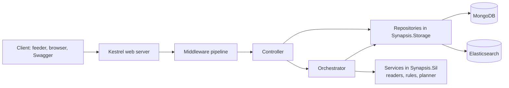
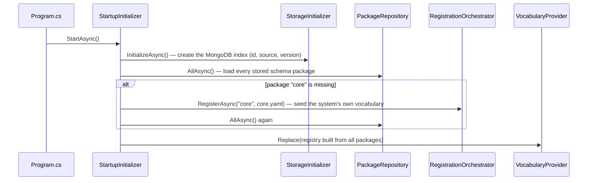
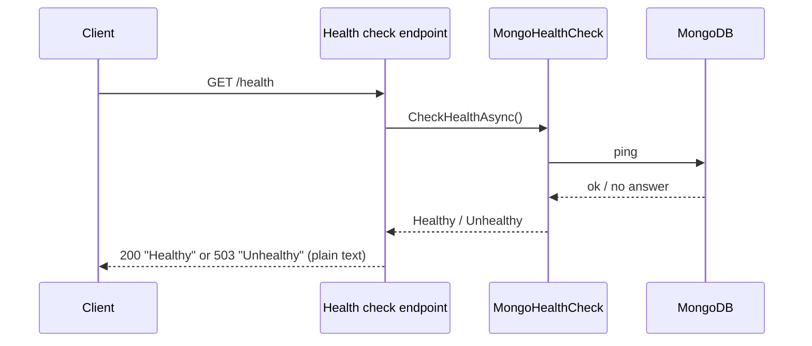
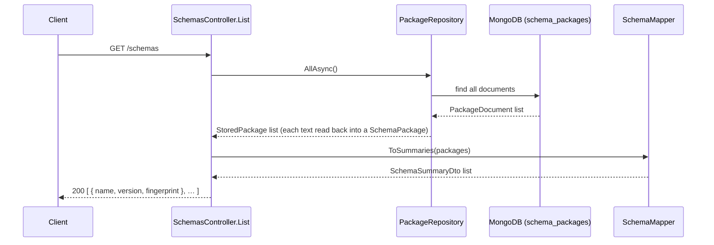
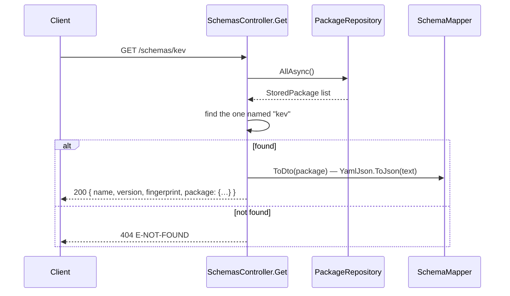
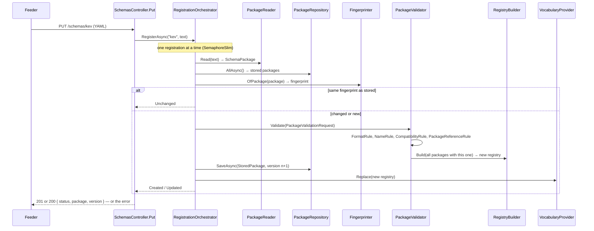
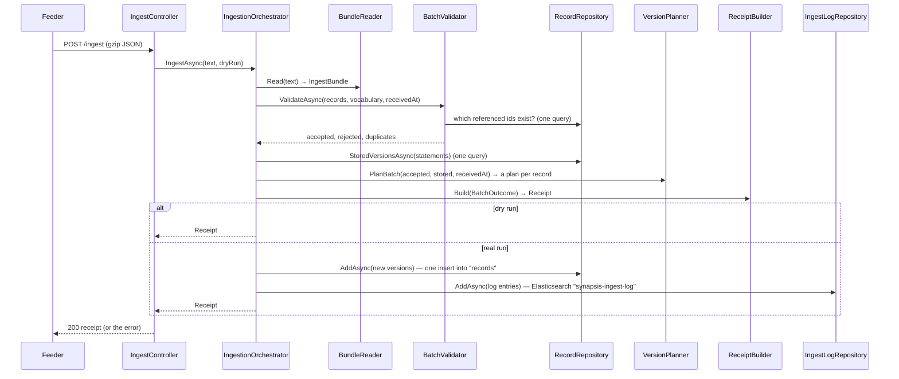
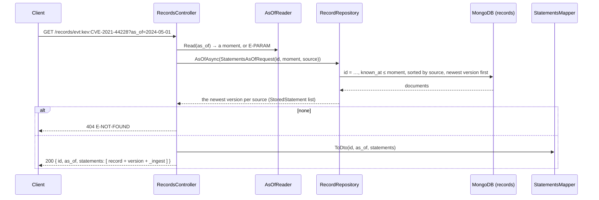

# Understanding the Synapsis API

This guide walks through the C# API one request at a time. It is written for a developer with a few months of C#
experience: every term is explained the first time it appears, and every diagram follows a real request through the
real classes. Open the files as you read; the class names here are the file names in `src/dotnet/`.

---

## 1. What the API does, in one paragraph

Programs called **feeders** read public data sources (vulnerabilities, earthquakes, banks, …) and send it to the API
as **records**. The API checks every record against a set of rules, stores each one in **MongoDB** (a database that
keeps JSON documents), never overwrites history (a changed record becomes a new *version*), and writes a short summary
of every batch to **Elasticsearch** (a search engine the web client reads to show what is arriving). Anyone can then
ask: "what did we know about this record on a given date?"

## 2. Words you need first

| Word | Plain meaning |
| --- | --- |
| **SIL record** | One fact in Synapsis's JSON format ("SIL 1.2"). Four kinds: `entity` (a thing: a bank, a CVE), `event` (something that happened), `relation` (a link between two entities), `conclusion` (a finding). Each has an `id`, a `source`, a `type`, and `known_at` (when the fact became known). |
| **Batch / bundle** | What a feeder sends in one request: `{ "sil": "1.2", "batch_id", "producer", "records": [up to 5,000] }`. |
| **Schema package** | A YAML file a feeder owns (in `feeders/packages/`) that declares its sources, record types, measures and roles. The API refuses records that use words no package declared. |
| **Vocabulary / registry** | All registered packages turned into fast lookup tables in memory (`IRegistry`). Rules ask it questions such as "is `src:cisa:kev` a known source?". |
| **Statement** | One record id *from one source*. The same id from two sources is two statements. |
| **Version** | Each time a statement's content changes, a new version is stored (1, 2, 3, …). Old versions stay forever. |
| **Fingerprint** | A hash (a short code computed from the content). Same content → same fingerprint, so "did it change?" is one comparison. |
| **`as_of`** | A date in a question: "answer with only what was known by then". |
| **`Result` / `Problem`** | How every step answers. A `Result` is either a success (with a value) or a failure holding a `Problem` = an error **code** (like `E-UNIT`), a **path** (where in the record, like `measures[2].unit`) and a **message**. Expected failures are answers, not exceptions. |
| **Dependency injection (DI)** | Classes do not create the services they use; they list them in their constructor, and ASP.NET Core hands them in. All of this is set up in one place: `Program.cs`. |
| **async / await** | A method marked `async` can wait for the database without blocking a thread. Such methods end in `Async`. |
| **Middleware** | A step every request passes through before reaching a controller (decompress the body, catch errors, …). |
| **Controller** | The class that receives one kind of HTTP request. Ours are thin: read the input, call one process, turn the answer into JSON. |
| **Orchestrator** | A class that runs a process by calling several services in order. It contains no rules of its own. |
| **Service** | A class that does one job (read a bundle, check a rule, plan a version). |
| **Repository** | A class that stores and loads data in the shape the program needs, hiding the database details. |

## 3. The layers

The code is split into three projects. Each one may only use the ones below it.

| Project | Holds | Talks to |
| --- | --- | --- |
| `Synapsis.Api` | Controllers, the two orchestrators, HTTP helpers, `Program.cs` | Sil, Storage |
| `Synapsis.Storage` | Repositories, database connection (`Dal/`), database documents (`Entities/`) | MongoDB, Elasticsearch, Sil |
| `Synapsis.Sil` | The record language: reading, rules, fingerprints, version planning. No database, no HTTP. | nothing |

Inside every project the folders are the same: `Models/` (data only), `Services/` (one job each; the interface
`IThing.cs` sits next to `Thing.cs`), `Orchestrators/` (processes).



Simple reads (lists, a record by id) go straight from the controller to a repository: there is no process to
coordinate, so an orchestrator would add nothing.

## 4. What happens before the first request

When the API starts, `Program.cs` registers every class for dependency injection, then `StartupInitializer` runs once:



From now on `VocabularyProvider.Current` holds the vocabulary in force. It changes only when a package is registered.

## 5. The path every request takes

Before any controller runs, the request goes through these steps, in this order (see `Program.cs`):

1. **Kestrel** (the web server inside ASP.NET Core) receives the request. A body larger than `Api:MaxBodyMb`
   (64 MB) is stopped here.
2. **`UseExceptionHandler`** wraps everything after it. If a later step throws, `ProblemExceptionHandler` turns the
   exception into our error JSON:
   - a body marked gzip that is not gzip → `E-BUNDLE` (400);
   - a body over the limit → `E-TOO-LARGE` (413);
   - MongoDB not answering → `E-UNAVAILABLE` (503);
   - anything else is a bug → 500.
3. **`UseRequestDecompression`** unzips a body sent with `Content-Encoding: gzip` (feeders send gzip).
4. **`UseCors`** lets the web client (`http://localhost:1897`) call the API from a browser.
5. **`UseSwagger` / `UseSwaggerUI`** answer `/swagger` (the test page) and `/swagger/v1/swagger.json`.
6. **`MapControllers`** picks the controller method whose route matches; **`MapHealthChecks`** answers `/health`.

There is no authentication: every route is open (for now).

Every error answer has the same JSON shape, made by `ErrorMapper.ToResult`:

```json
{ "code": "E-NOT-FOUND", "message": "no record 'evt:x:1' known by now", "details": [ { "path": "...", "message": "..." } ] }
```

The HTTP status comes from the code (`ProblemStatuses.Of`): `E-BUNDLE`/`E-PARAM` 400, `E-NOT-FOUND` 404,
`E-SCHEMA-OWNERSHIP`/`-BREAKING`/`-VERSION` 409, `E-TOO-LARGE` 413, `E-SCHEMA-PACKAGE`/`-REF` 422, `E-UNAVAILABLE` 503.

---

## 6. `GET /health`

**Purpose:** "Is the API up, and can it reach MongoDB?" Docker calls it every 10 seconds.

**Parameters:** none.



**Step by step**
1. The built-in health-check endpoint (no controller) runs every registered check; there is one, `MongoHealthCheck`.
2. `MongoHealthCheck` sends MongoDB a `ping` command through `MongoContext`.
3. The answer is plain text, not JSON.

---

## 7. `GET /schemas`

**Purpose:** list every registered schema package (the web client shows them).

**Parameters:** none.



**Step by step**
1. `SchemasController.List` asks `IPackageRepository.AllAsync()` for every package.
2. `PackageRepository` reads the `schema_packages` collection. Each document (`PackageDocument`: `_id` = the package
   name, `version`, `fingerprint`, `text`) is mapped by `PackageDocumentMapper` to a `StoredPackage`.
3. `SchemaMapper.ToSummaries` keeps three fields per package; ASP.NET Core writes them as JSON in snake_case.

**Answer fields:** `name` (e.g. `kev`), `version` (1, 2, … — goes up each time the package changes), `fingerprint`
(changes whenever the text changes).

---

## 8. `GET /schemas/{package}`

**Purpose:** one package in full, as JSON.

| Parameter | Where | Meaning |
| --- | --- | --- |
| `package` | path | The package name, e.g. `kev`. |



**Step by step**
1. Same read as `GET /schemas`, then a simple loop finds the package by name (24 packages: a loop is fine).
2. `SchemaMapper.ToDto` converts the stored YAML text to JSON with `YamlJson.ToJson`, so the client gets the
   package's sources, types, measures, roles and namespaces as normal JSON.

---

## 9. `PUT /schemas/{package}`

**Purpose:** register a package, or a new version of it. Feeders call it at start-up with their YAML file.

| Parameter | Where | Meaning |
| --- | --- | --- |
| `package` | path | The package name; must equal the `name` inside the file. |
| body | YAML or JSON text | The package file. |



**Step by step**
1. `SchemasController.Put` reads the body as text and calls `IRegistrationOrchestrator.RegisterAsync(name, text)`.
2. `RegistrationOrchestrator` lets only one registration run at a time (a `SemaphoreSlim` is a lock that works with
   `await`), because each one builds on the vocabulary the previous one left.
3. `PackageReader.Read` turns the text into a `SchemaPackage` object (`E-SCHEMA-PACKAGE` if it cannot).
4. If the fingerprint equals the stored one, nothing changed: answer `unchanged` with the current version.
5. `PackageValidator.Validate` runs the package rules in order; the first failure is the answer:
   - `FormatRule`: the file matches the package format (`schemas/sil/schema-package.schema.json`) → `E-SCHEMA-PACKAGE`;
   - `NameRule`: the name in the file equals the name in the URL;
   - `CompatibilityRule`: compared with the stored version, nothing was removed and no unit changed → `E-SCHEMA-BREAKING`;
   - `PackageReferenceRule`: every type, role and measure it mentions exists somewhere → `E-SCHEMA-REF`;
   - then `RegistryBuilder.Build` builds the whole vocabulary with this package; a code defined by two packages →
     `E-SCHEMA-OWNERSHIP`.
6. `PackageRepository.SaveAsync` stores it as version n+1, but only if nobody saved another version in the meantime
   (`E-SCHEMA-VERSION`).
7. `VocabularyProvider.Replace` puts the new vocabulary in force for the next batches.
8. `RegistrationMapper` turns the result into `201 Created` (first version) or `200` (updated or unchanged).

---

## 10. `POST /ingest`

**Purpose:** the main job: take a batch of records, check them, store what is new or changed, and say what happened.

| Parameter | Where | Meaning |
| --- | --- | --- |
| `dry_run` | query, `true`/`false` (default `false`) | `true` = check and answer, but store nothing and log nothing. |
| body | JSON, optionally gzip | The batch: `sil` ("1.2"), `batch_id`, `producer`, `records` (≤ 5,000). |



**Step by step**
1. **Controller.** `IngestController.Post` reads the (already unzipped) body as text and calls
   `IIngestionOrchestrator.IngestAsync(text, dryRun)`.
2. **Read the bundle.** `BundleReader.Read` parses the JSON and checks the envelope: valid JSON with `sil`,
   `batch_id`, `producer` and `records` (`E-BUNDLE`), at most 5,000 records (`E-TOO-LARGE`). The result is an
   `IngestBundle` whose `Records` are still raw JSON. A refused bundle stops everything here.
3. **Note the time.** The receive time is taken once, cut to whole milliseconds (`Instant.ToMilliseconds`) because
   MongoDB stores dates to the millisecond.
4. **Validate.** `BatchValidator.ValidateAsync` checks each record on its own with `RecordValidator`, then the batch
   as a whole. A record stops at the **first** rule it breaks, and that rule's code is its answer:
   - envelope rules on the raw JSON: 1 `KindRule` (`E-KIND`), 2 `StructureRule` (the JSON Schema: `E-SCHEMA`);
   - the record is read into its C# class (`EntityRecord`, `EventRecord`, …);
   - record rules: 3 `SourceRule`, 4 `IdentityRule` (id namespace), 5 `TypeRule`, 6 `ValidTimeRule`,
     7 `KnowledgeTimeRule` (`known_at` not before the event, not in the future), 8 `PlaceRule`, 9 `MeasureRule`,
     10 `TextRule`, 11 `AttributeRule`, 12 `ConclusionRule`;
   - a passing record gets its fingerprint and becomes a `CheckedRecord`;
   - batch rules (rule 13): `DuplicateRule` drops identical copies and refuses two different records with the same
     id; `ReferenceRule` refuses records pointing at entities or records that exist neither in the batch nor in
     MongoDB (one query for the whole batch).
   The answer is a `BatchValidationResult`: `Accepted`, `Rejected` (each a `Rejection` = index, id, `Problem`) and the
   number of `Duplicates`.
5. **Look up history.** `VersionPlanner.StatementsOf` lists the (id, source) pairs; `RecordRepository.StoredVersionsAsync`
   fetches their stored versions in one query (version, fingerprint, `known_at` only — not the whole record).
6. **Plan versions.** `VersionPlanner.PlanBatch` decides for each accepted record, with four rules:
   1. nothing stored → **new**, version 1;
   2. same fingerprint as the latest version → **unchanged** (nothing to write);
   3. an older `known_at` that matches the version that was current at that time (a re-read of the past) → **unchanged**;
   4. otherwise → **next version** (n+1). Its `known_at` is the record's own if it is after the latest and not in
      the future; otherwise the receive time, marked `known_at_basis: "ingested"`.
   The answer is one `PlannedRecord` (record + `VersionPlan`) per accepted record.
7. **Receipt.** `ReceiptBuilder.Build(BatchOutcome)` counts everything and picks a status: `rejected` (all refused),
   `partial` (some refused), `unchanged` (nothing new), else `accepted`. On a dry run the answer stops here.
8. **Store.** `RecordVersionMapper.ToRecordVersions` turns the plans that store something into `RecordVersion`s;
   `RecordRepository.AddAsync` inserts them in one unordered `InsertMany` into the `records` collection. Each document
   (`RecordDocument`) has `_id = "{id}|{source}|{version}"`, so two writers storing the same version collide; that
   rare case answers `E-UNAVAILABLE` (send again).
9. **Log.** `IngestLogMapper.ToEntries` makes one `IngestLogEntry` per source in the batch (received, new, changed,
   unchanged, duplicates, rejected, counts per error code, the first 50 refusals, duration).
   `IngestLogRepository.AddAsync` writes them to the Elasticsearch index `synapsis-ingest-log` with the official
   client (`Elastic.Clients.Elasticsearch`). If Elasticsearch fails, a warning is logged and the request still
   succeeds: the log must never stop data from being stored.
10. **Answer.** `ReceiptMapper.ToDto` turns the receipt into JSON:

```json
{
  "batch_id": "kev-2026-10-10", "status": "partial", "producer": "feeder:kev",
  "received_at": "2026-10-10T08:15:00.123Z",
  "counts": { "received": 6, "new": 5, "versioned": 0, "unchanged": 0, "duplicates": 0, "rejected": 1 },
  "rejected": [ { "index": 5, "id": "ent:cve:CVE-2099-0001", "code": "E-KIND", "path": "kind", "message": "…" } ],
  "dry_run": false
}
```

A refused **record** is a normal answer (200 with `rejected` filled in). Only a refused **request** (bad bundle,
too large, database down) is an error status.

---

## 11. `GET /records/{id}`

**Purpose:** "what did each source say about this record, as known at a date?"

| Parameter | Where | Meaning |
| --- | --- | --- |
| `id` | path | The record id, e.g. `evt:kev:CVE-2021-44228` (may contain `:` and `/`). |
| `as_of` | query, optional | A date (`2024-05-01` = end of that day) or an instant (`2024-05-01T12:00:00Z`). Empty = now. |
| `source` | query, optional | Only this source, e.g. `src:cisa:kev`. |



**Step by step**
1. `AsOfReader.Read` turns `as_of` into a UTC moment (`E-PARAM` if it is neither a date nor an instant).
2. `RecordRepository.AsOfAsync` runs one query: this id, `known_at` up to the moment, from the one source if asked,
   sorted by source and then newest version first. It keeps the first document of each source: that source's
   latest version known at that moment.
3. `StatementsMapper.ToDto` returns each stored record with two extra fields: `version`, and `_ingest`
   (`batch_id`, `producer`, `received_at`: which batch delivered it).

---

## 12. The models you will meet most

| Model | Project | What it holds |
| --- | --- | --- |
| `IngestBundle` | Sil | A read batch: `Sil`, `BatchId`, `Producer`, `Records` (raw JSON). |
| `SilRecord` (+ `EntityRecord`, `EventRecord`, `RelationRecord`, `ConclusionRecord`) | Sil | One record as C# objects. |
| `Result`, `Result<T>`, `Problem` | Sil | The uniform answer: success (with a value) or a problem (`Code`, `Path`, `Message`). |
| `CheckedRecord` | Sil | A record that passed rules 1–12: `Index` (position in the batch), `Raw`, `Record`, `Fingerprint`. |
| `Rejection` | Sil | A refused record: `Index`, `Id`, `Problem`. |
| `BatchValidationResult` | Sil | `Accepted`, `Rejected`, `Duplicates`. |
| `StatementKey` | Sil | An (id, source) pair. |
| `StoredVersion` | Sil | What the planner needs about a stored version: `Version`, `Fingerprint`, `KnownAt`. |
| `VersionPlan`, `PlannedRecord` | Sil | The decision for one record (`Outcome`: New / Unchanged / NewVersion, `Version`, `KnownAt`, the record to store). |
| `SchemaPackage` | Sil | A package file as C# objects. |
| `RecordVersion` | Storage | One version to store: key, kind, version, `KnownAt`, fingerprint, record, batch id, producer, `ReceivedAt`. |
| `RecordDocument`, `PackageDocument` | Storage | Exactly how MongoDB stores a version / a package (never leave Storage). |
| `StoredPackage`, `StoredStatement` | Storage | What a repository returns after a read. |
| `IngestLogEntry` | Storage | One Elasticsearch log document (fields in `contracts/synapsis-api.yaml`). |
| `BatchOutcome`, `Receipt` | Api | Everything that happened to one batch; the summary sent back. |
| `…Dto` | Api | The exact JSON shapes of HTTP answers. |

## 13. Where to look next

- Try every route in the browser: `http://localhost:8080/swagger`.
- The route and log contract the web client uses: `contracts/synapsis-api.yaml`.
- The record format: `schemas/sil/`; the conformance cases every API must pass: `tests/conformance/`.
- How the parts are wired together: `Program.cs`, `SilRegistration.cs`, `StorageRegistration.cs`.
